<div align="center">

# ✂️ RHB Hair Studio

### A full-stack salon booking and management system built with Blazor WebAssembly and ASP.NET Core

Customers book appointments in under a minute. The salon manages its whole business from one dashboard.


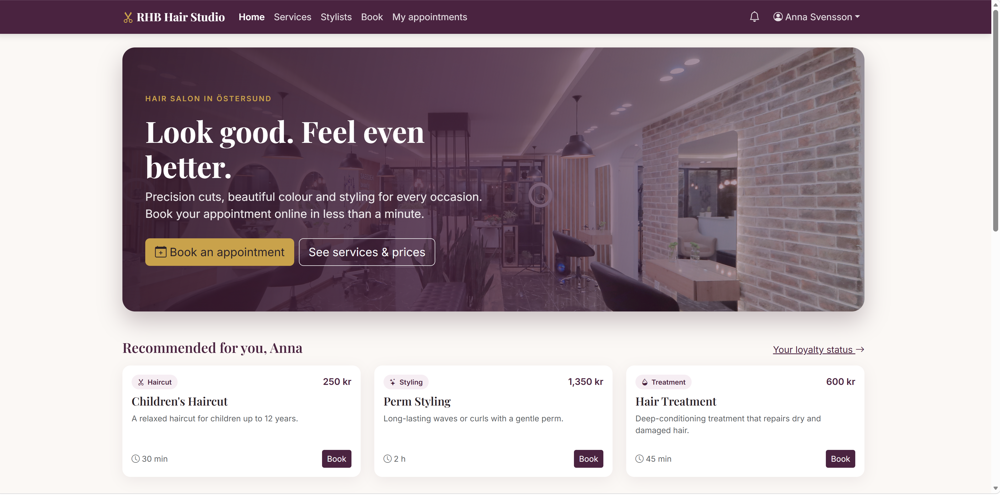

[Features](#-features) · [Screenshots](#-screenshots) · [Architecture](#-architecture) · [Tech stack](#-tech-stack) · [Run it locally](#-run-it-locally) · [API](#-api-overview)

</div>

---

##  About the project

Many small salons still take bookings by phone and keep track of them on paper. **Nordic Hair Studio** shows how a modern salon could run instead.

- **Customers** browse services and stylists, see real free times, book online, get reminders, review their visit and earn loyalty discounts.
- **The salon** confirms bookings, manages services, staff and customers, and follows revenue and trends in reports.

The project is a complete full-stack application. A **Blazor WebAssembly** front end talks to a secured **ASP.NET Core Web API** over HTTPS. The API uses **Entity Framework Core** and **ASP.NET Core Identity** with **JWT** authentication, and it is organised in clear layers with all business rules in the server.

> Built as the final assignment in *Programming in C# III* at Malmö University, then extended into a portfolio project.

---

## 🎬 Demo


*A customer books an appointment. The free times are calculated live from opening hours and existing bookings.*

---

##  Features

### For customers
| | |
|---|---|
|  **Browse and search** | Services with search and category filter; stylists with ratings and specialities |
|  **Smart booking** | Pick a service, stylist and date; only **genuinely free times** are shown |
|  **My appointments** | Upcoming and past visits; **move** or **cancel** upcoming bookings |
|  **Notifications** | A bell with an unread counter: booking received, confirmed, moved, cancelled |
|  **Reminders** | An automatic reminder 24 hours before every confirmed visit |
|  **Reviews** | Rate completed visits (1–5 stars); every stylist has a profile with reviews |
|  **Loyalty programme** | Points on every visit. **Silver gets 5 %** and **Gold gets 10 %** off new bookings |
|  **Favourites and recommendations** | Save favourite stylists; get suggestions for services you haven't tried |

### For the salon (admin)
| | |
|---|---|
|  **Dashboard** | Bookings this week, approvals waiting, revenue, active customers, popular services, today's schedule |
|  **Appointment management** | Filter by status, stylist, date and text; confirm, complete, move or cancel, with a message to the customer |
|  **Services and stylists** | Full create, edit and delete management, with safe deactivation when history exists |
|  **Customer management** | Booking history, total spent, favourite stylist, loyalty tier; lock and unlock accounts |
|  **Reports** | Revenue per month, by service and by category; top customers; stylist performance; busiest day and hour |

---

##  Screenshots

###  Customer experience
 
<table>
  <tr>
    <td width="50%"><br/><b>Home</b>: personal recommendations, popular services, top-rated stylists and reviews</td>
    <td width="50%">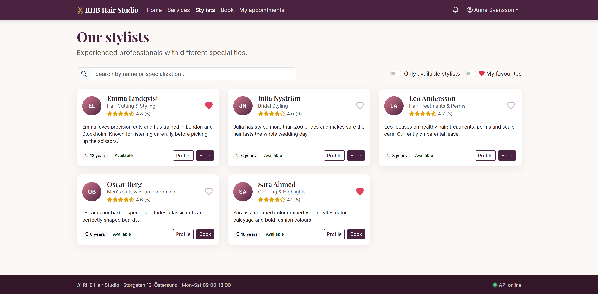<br/><b>Stylists</b>: ratings, specialities, availability and favourite hearts</td>
  </tr>
  <tr>
    <td width="50%">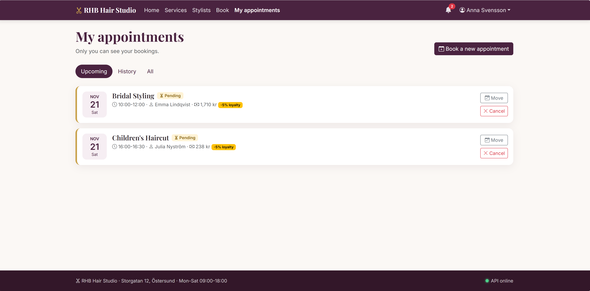<br/><b>My appointments</b>: upcoming and past visits; move, cancel or review</td>
    <td width="50%">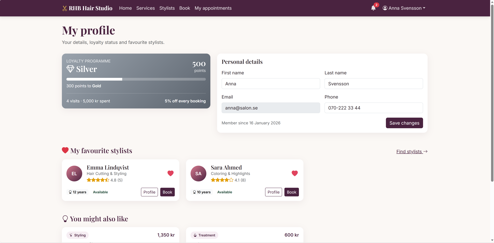<br/><b>My profile</b>: loyalty tier and points, personal details, favourite stylists</td>
  </tr>
</table>
### 🛠️ Admin area
 
<table>
  <tr>
    <td width="50%">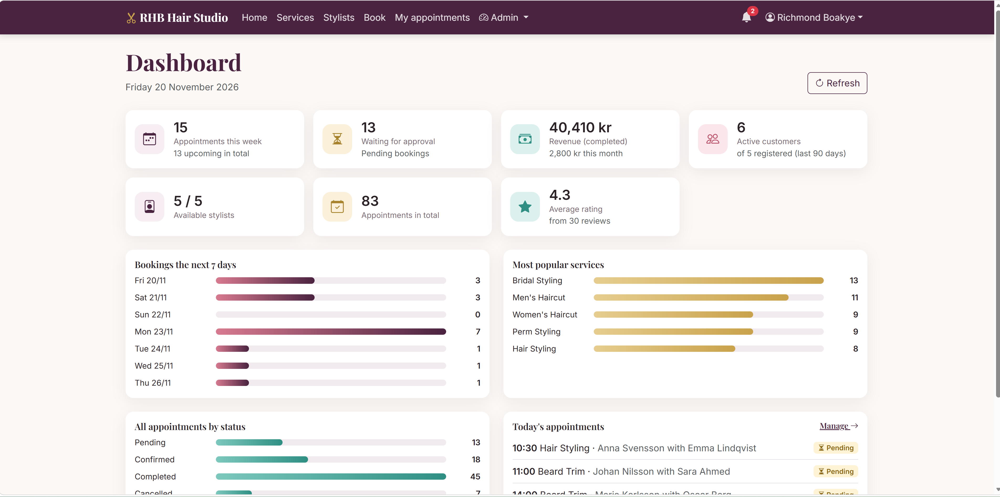<br/><b>Dashboard</b>: the key numbers of the business at a glance</td>
    <td width="50%">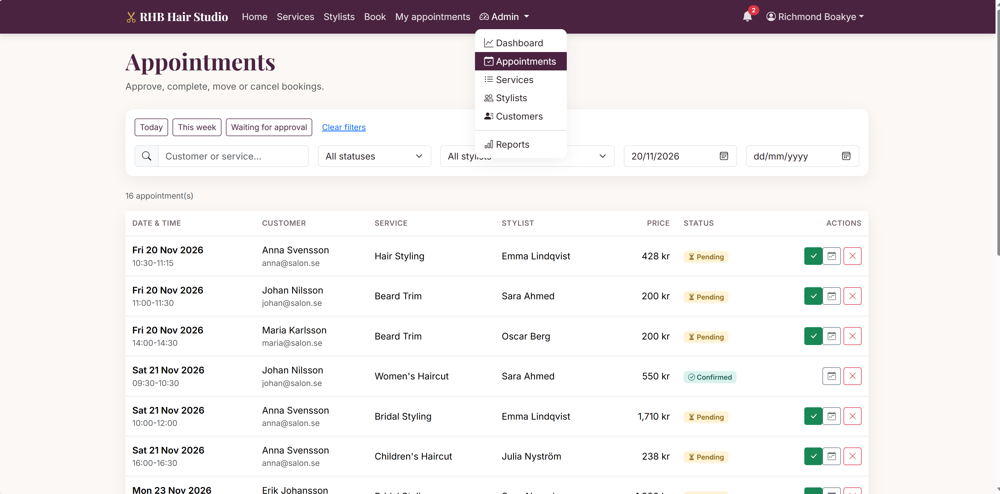<br/><b>Appointments</b>: filter, confirm, complete, move or cancel bookings</td>
  </tr>
  <tr>
    <td width="50%">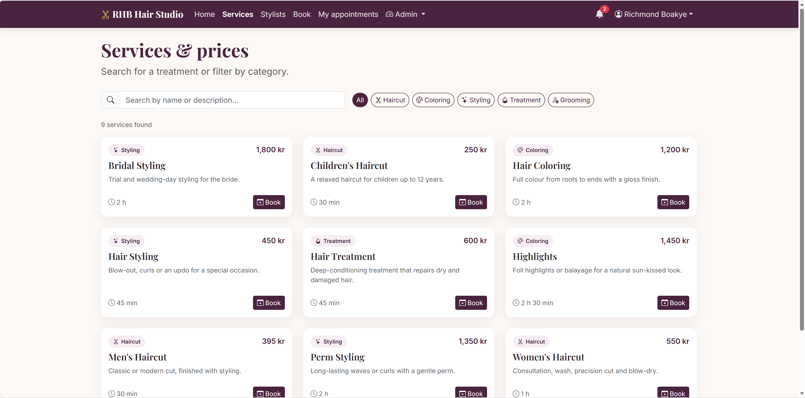<br/><b>Services</b>: search, category filter and full create, edit and delete management</td>
    <td width="50%">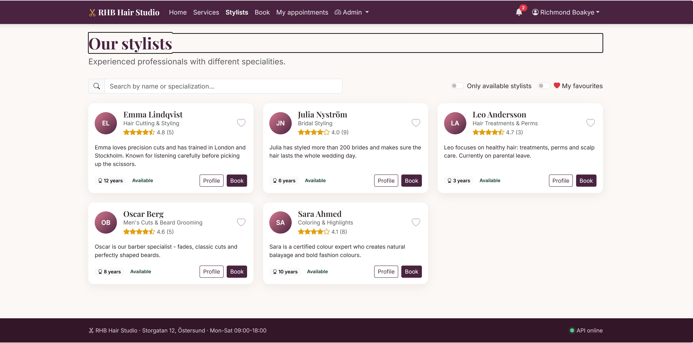<br/><b>Stylists</b>: team overview with ratings and availability</td>
  </tr>
  <tr>
    <td colspan="2">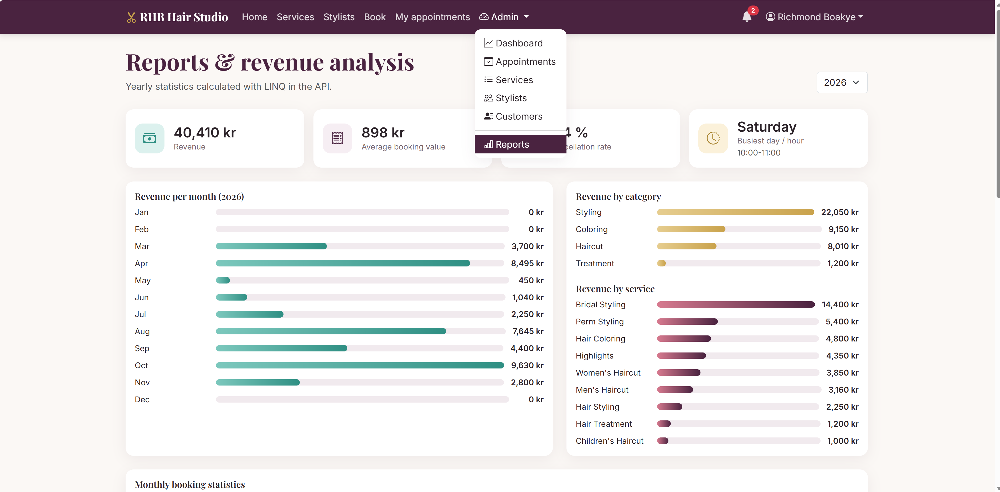<br/><b>Reports &amp; revenue analysis</b>: revenue per month, by service and by category; top customers and stylist performance</td>
  </tr>
</table>

---

##  Architecture

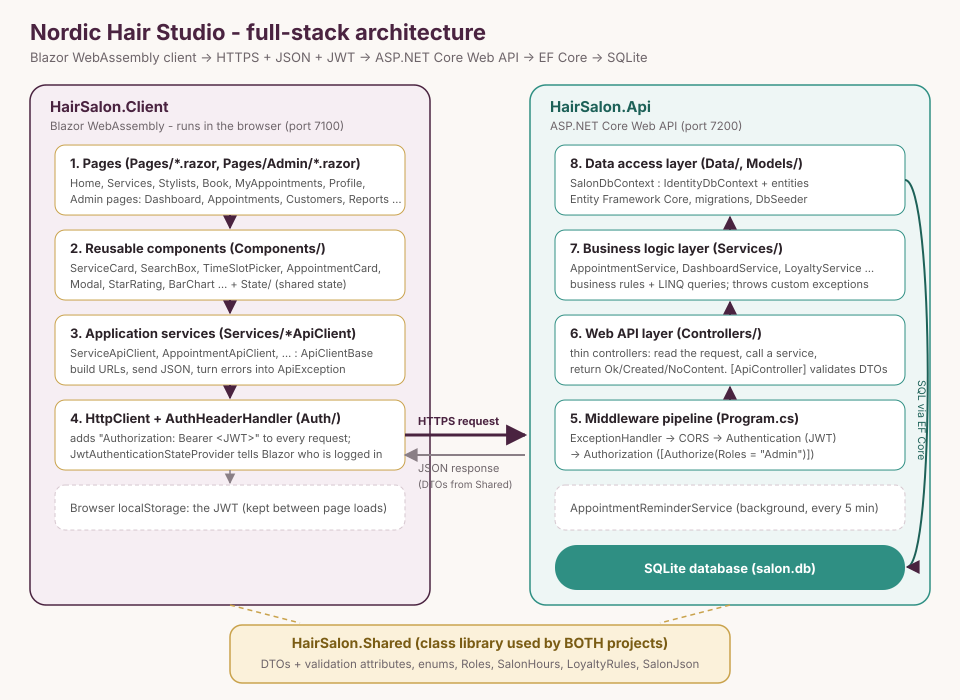

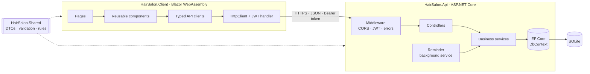

| Project | Responsibility |
|---|---|
| **HairSalon.Client** | The user interface. Runs in the browser and has **no database access**; all data comes from the API |
| **HairSalon.Api** | Security, business rules, data access and background jobs |
| **HairSalon.Shared** | DTOs, validation attributes, enums and business rules shared by both sides, so validation is written once and runs in the browser **and** on the server |

### Design decisions

- **Thin controllers, rich services.** Controllers only translate HTTP. Every rule (opening hours, double bookings, allowed status changes, loyalty discounts) lives in the service layer, so it can't be bypassed by a modified client.
- **Global error handling.** Services throw `BusinessRuleException`, `NotFoundException` or `ForbiddenException`. One `IExceptionHandler` turns them into clean `400`/`404`/`403` JSON responses. There is no `try/catch` in the controllers.
- **Identity comes from the token, never the request.** The user id is read from the JWT, so nobody can book or read data in someone else's name.
- **Price snapshots.** The price is stored on each booking, so changing a service's price never rewrites history or revenue.
- **Calculated, not stored.** Loyalty points are calculated from completed visits, so they can never get out of sync.
- **Safe deletes.** Services and stylists with bookings are deactivated instead of deleted.
- **Background processing.** A `BackgroundService` with `PeriodicTimer` sends reminders, using its own DI scope for each run.

 There is a full walk-through in **[docs/ARCHITECTURE.md](docs/ARCHITECTURE.md)**: request flow, authentication flow, data model, component communication, LINQ and dependency injection lifetimes.

### Data model

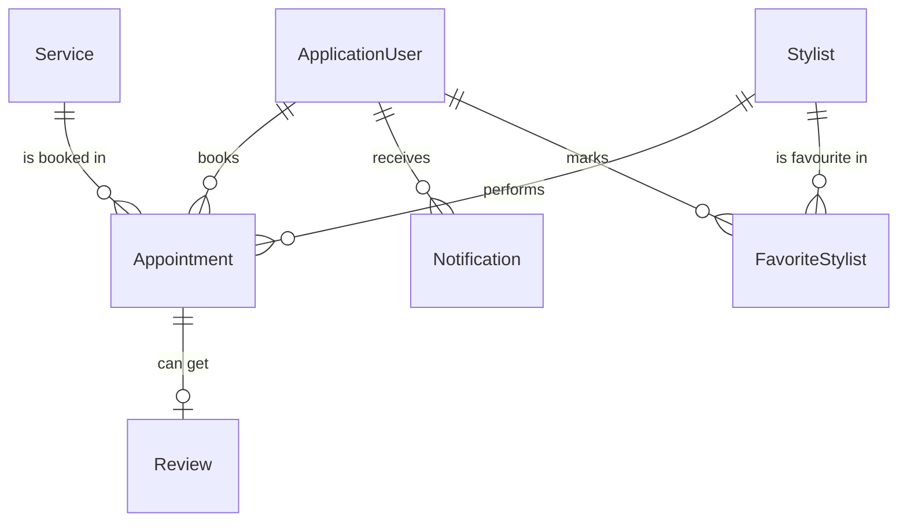

---

## 🧰 Tech stack

| Area | Technology |
|---|---|
| Front end | Blazor WebAssembly (.NET 10), Razor components, Bootstrap 5.3, Bootstrap Icons, custom CSS (charts in pure HTML/CSS) |
| Back end | ASP.NET Core Web API (.NET 10), controllers, `IExceptionHandler`, `BackgroundService` |
| Data | Entity Framework Core 10, SQLite, code-first migrations, Fluent API (one-to-one, one-to-many, many-to-many with a composite key) |
| Security | ASP.NET Core Identity, JWT bearer tokens, role-based authorization, CORS, User Secrets |
| Language | C# 14: primary constructors, records, collection expressions, pattern matching, LINQ |
| Tools | Visual Studio, Swagger (Swashbuckle), Git and GitHub |

### What I practised

- Designing a **layered architecture** across two applications and a shared contract library
- **JWT authentication** end to end, including a custom `AuthenticationStateProvider` and a `DelegatingHandler`
- **Advanced LINQ** for statistics: `GroupBy`, `ToLookup`, projections and aggregations, plus knowing when to run them in SQL and when in memory
- **Component communication** in Blazor: parameters, `EventCallback`, two-way binding, `RenderFragment` and shared state services
- Writing **business rules** that stay correct when two users act at the same time (such as double-booking protection)

---

##  Run it locally

### Requirements
- [.NET 10 SDK](https://dotnet.microsoft.com/download)
- Visual Studio 2026 (or VS 2022 17.14+) with the **ASP.NET and web development** workload, VS Code, or Rider

### 1. Clone
```bash
git clone https://github.com/richmondbh/HairSalon.git
cd HairSalon
```

### 2. Set the JWT secret (once)
The signing key is **not** stored in the repository. Store it in User Secrets:
```bash
dotnet user-secrets set "Jwt:Key" "any-random-text-with-at-least-32-characters" --project HairSalon.Api
```

### 3. Start the API and the client

**Visual Studio:** right-click the solution → *Configure Startup Projects* → *Multiple startup projects* → start **HairSalon.Api** (first) and **HairSalon.Client** → press **F5**.

**Command line** (two terminals):
```bash
dotnet run --project HairSalon.Api --launch-profile https
dotnet run --project HairSalon.Client --launch-profile https
```

| App | URL |
|---|---|
| Website | https://localhost:7100 |
| API (Swagger) | https://localhost:7200/swagger |

On first start the API **creates the database, applies the migrations and seeds realistic demo data**: services, stylists, customers, about 70 appointments, reviews and notifications, all relative to today's date.

> 💡 Delete `salon.db*` in `HairSalon.Api` to start again with fresh demo data.

### Demo accounts
| Role | Email | Password |
|---|---|---|
| Admin | `admin@salon.se` | `Admin123!` |
| Customer (Silver member) | `anna@salon.se` | `Customer123!` |

The login page has one-click buttons that fill in both accounts.

---

## 🔌 API overview

The API has 40+ REST endpoints across 10 controllers. They are all documented and testable in **Swagger**: log in with `POST /api/auth/login`, then click **Authorize**.

| Area | Endpoints | Access |
|---|---|---|
| Auth | `POST /api/auth/register` · `POST /api/auth/login` · `GET/PUT /api/auth/profile` | Public / logged in |
| Services | `GET /api/services?search=&category=` · `GET /popular` · `GET /recommended` · `POST/PUT/DELETE` | Public / Admin |
| Stylists | `GET /api/stylists?search=&onlyAvailable=` · `GET /top` · `POST/PUT/DELETE` | Public / Admin |
| Appointments | `GET /available-slots` · `POST` · `GET /mine` · `PUT /{id}/cancel` · `PUT /{id}/reschedule` | Logged in |
| Appointments (admin) | `GET /api/appointments?status=&stylistId=&from=&to=` · `PUT /{id}/status` | Admin |
| Dashboard and reports | `GET /api/dashboard` · `GET /api/dashboard/report?year=` | Admin |
| Customers | `GET /api/customers` · `GET /{id}` · `PUT /{id}/lock` · `PUT /{id}/unlock` | Admin |
| Notifications | `GET` · `GET /unread-count` · `PUT /{id}/read` · `PUT /read-all` · `DELETE` | Logged in |
| Reviews | `POST /api/reviews` · `GET /stylist/{id}` · `GET /latest` | Logged in / Public |
| Favourites | `GET /api/favorites` · `POST/DELETE /{stylistId}` | Logged in |

Errors are always returned as `{ "message": "..." }` with the right status code (`400`, `401`, `403`, `404`).

---

##  Security

- Passwords are hashed by **ASP.NET Core Identity**; the JWT key is kept in **User Secrets**, not in Git.
- **Every rule is enforced by the API.** The client only hides what the user can't do.
- Role-based access (`Admin`, `Customer`) on both API endpoints and pages.
- Users can only reach their **own** data; the user id always comes from the signed token.
- **CORS** only allows the website's own origin.
- Errors never leak stack traces or SQL; details are logged on the server.
- Admins can **lock** accounts, which blocks login.

---

##  Project structure

```
HairSalon/
├── HairSalon.Shared/      DTOs + validation, enums, business rules (Roles, SalonHours, LoyaltyRules)
├── HairSalon.Api/
│   ├── Controllers/       Web API layer
│   ├── Services/          Business logic + reminder background service
│   ├── Data/              SalonDbContext, DbSeeder
│   ├── Models/            EF Core entities
│   ├── Migrations/        EF Core migrations
│   ├── Infrastructure/    Exceptions, global error handler, claims helpers
│   └── Mapping/           Entity → DTO mapping
├── HairSalon.Client/
│   ├── Pages/             Routable pages (Pages/Admin = admin area)
│   ├── Components/        25+ reusable components
│   ├── Services/          Typed API clients
│   ├── Auth/              JWT storage, auth state provider, header handler
│   ├── State/             Shared state (toasts, notifications)
│   └── wwwroot/           index.html, CSS, images, libraries
├── docs/                  Architecture documentation and diagram
└── images/                Screenshots for this README
```

---

##  Roadmap

- [ ] Real-time notifications with **SignalR** instead of polling
- [ ] Email and SMS reminders
- [ ] Online payment and deposits
- [ ] Waiting list that notifies customers when a time becomes free
- [ ] Staff working schedules and holidays
- [ ] Automated tests (xUnit + bUnit) and a CI pipeline with GitHub Actions
- [ ] Cloud deployment (Azure App Service + Azure Static Web Apps)

<details>
<summary><b> Course requirements (Malmö University, Programming in C# III, Assignment 4)</b></summary>

| Requirement | Where |
|---|---|
| Blazor app with EF Core + SQLite, CRUD for services, Identity login and registration, customers book and see their own appointments | `ManageServices.razor`, `Book.razor`, `MyAppointments.razor`, `AuthService` |
| Data through Web APIs, reusable components, search and filter, role-based authorization, separate endpoints, client- and server-side validation | `Services/*ApiClient.cs`, `Components/`, `[Authorize(Roles = ...)]`, Shared DTOs + `[ApiController]` |
| Admin dashboard, advanced LINQ, component communication, layered architecture, appointment status management | `Dashboard.razor`, `DashboardService`, `AppointmentService.AllowedTransitions` |
| Advanced features with business value | Notifications, reminders, reviews, loyalty programme, favourites, recommendations, customer management, reports |

</details>

---

##  Author

**Richmond**: systems development student at Mid Sweden University and founder of [RHB Digital](https://rhbdigital.se).

[](https://github.com/richmondbh)

*If you like the project, a ⭐ on the repository is appreciated!*
