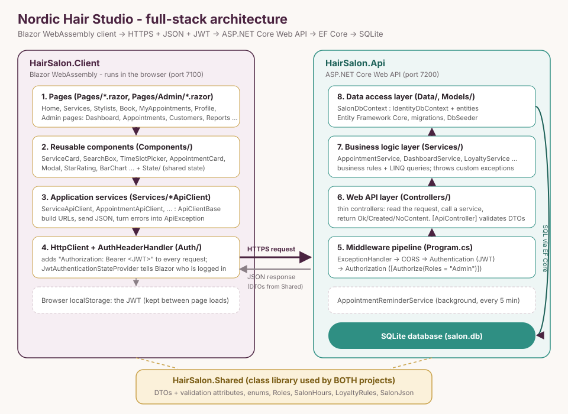
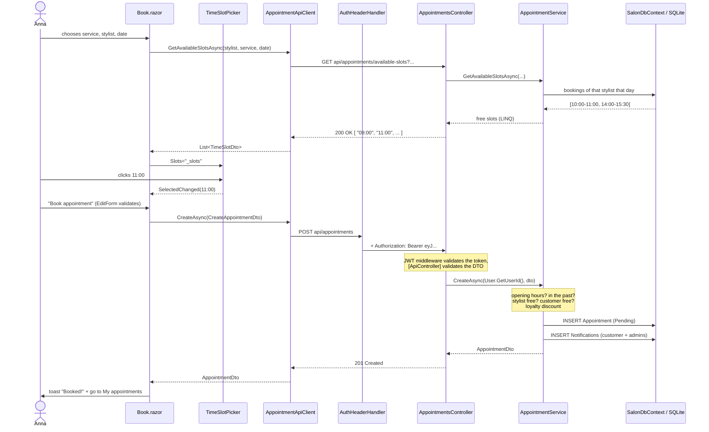
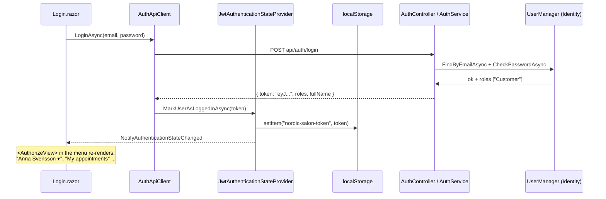
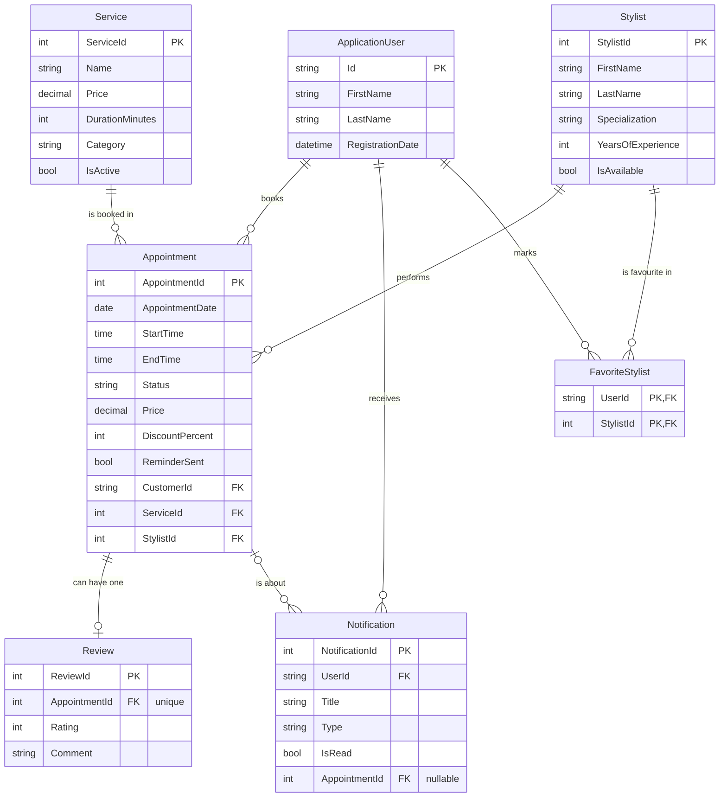

# Architecture – Nordic Hair Studio

This document explains **how the application is built and why**. Read it together with the code: every important class has comments that repeat the ideas below where they are used.



---

## 1. The big picture

The application is split into **two programs and one shared library**:

| | Runs where | Talks to | Knows about the database? |
|---|---|---|---|
| **HairSalon.Client** (Blazor WebAssembly) | In the **browser**. The C# code is downloaded as .NET assemblies and runs on WebAssembly | The API, over HTTPS | **No** |
| **HairSalon.Api** (ASP.NET Core Web API) | On the **server** (Kestrel, port 7200) | SQLite through EF Core | **Yes** |
| **HairSalon.Shared** (class library) | Inside **both** | – | No |

Why split it like this?

- **Security.** The browser is not trusted: anyone can open the developer tools and change the C# that runs there. So every rule that matters, such as "you may only cancel your own booking", is checked in the **API**. The client hides buttons for a better experience, but the API makes the decision.
- **Separation of concerns.** The client handles presentation; the API handles business rules and data.
- **Reuse.** The same API could serve a mobile app or another website.
- **Grade C requirement.** All data flows through Web API endpoints.

The **Shared** library is the *contract* between the two. When `CreateAppointmentDto` gets a new property, both sides see it at compile time, and the same validation attributes run in the browser and on the server.

---

## 2. The layers

The assignment suggests *Blazor UI → Application Services → Web API → EF Core → SQLite*. Our code follows it exactly:

```
┌──────────────────────── HairSalon.Client ────────────────────────┐
│ Pages/            routable pages (@page "/book")                 │
│ Components/       reusable UI pieces (ServiceCard, Modal, ...)   │
│ Services/         APPLICATION SERVICES = typed API clients       │
│ Auth/             HttpClient + AuthHeaderHandler (adds the JWT)  │
└───────────────────────────── HTTPS ──────────────────────────────┘
┌───────────────────────── HairSalon.Api ──────────────────────────┐
│ Program.cs        middleware: errors → CORS → JWT → authorization│
│ Controllers/      WEB API LAYER (thin)                           │
│ Services/         BUSINESS LOGIC LAYER (rules + LINQ)            │
│ Data/ + Models/   DATA ACCESS LAYER (EF Core DbContext/entities) │
└──────────────────────────── SQLite ──────────────────────────────┘
```

**The rule is that each layer only talks to the layer directly below it.** A page never builds a URL; it calls `AppointmentApi.CreateAsync(dto)`. A controller never writes a LINQ query; it calls `appointmentService.CreateAsync(...)`. This makes each part small, easy to read and easy to change.

### 2.1 The API layers

| Layer | Folder | Job | Example |
|---|---|---|---|
| Middleware | `Program.cs` | Cross-cutting work for **every** request | CORS, JWT validation, `[Authorize]`, global error handling |
| Controllers | `Controllers/` | HTTP in, HTTP out. Read route/query/body, call one service method, return `Ok(...)` / `CreatedAtAction(...)` / `NoContent()` | `AppointmentsController.Create` |
| Business services | `Services/` | All rules and queries. They throw exceptions when a rule is broken | `AppointmentService.CreateAsync` checks opening hours, double bookings and the stylist's availability |
| Data access | `Data/`, `Models/` | Entities, relationships, migrations, seed data | `SalonDbContext.OnModelCreating` |
| Infrastructure | `Infrastructure/`, `Mapping/` | Helpers used by several layers | `ApiExceptionHandler`, `ToDto()` |

**Why are the controllers so short?** Look at `AppointmentsController.Cancel`: it is one line. There is no `try/catch` because `AppointmentService` throws `BusinessRuleException("This appointment is already cancelled.")` and the global `ApiExceptionHandler` turns that into `400 Bad Request` with `{ "message": "..." }`. `NotFoundException` becomes 404 and `ForbiddenException` becomes 403. Error handling is written **once**.

**Entities vs DTOs.** The API never returns an entity. `Appointment` (entity) has navigation properties such as `Customer` (with password hash!), and `Service.Appointments`, which would cause endless loops in JSON. `AppointmentDto` contains exactly what the UI needs (`ServiceName`, `StylistName` ...). `Mapping/MappingExtensions.cs` converts entities to DTOs by hand so you can see every property.

### 2.2 The client layers

| Layer | Folder | Job |
|---|---|---|
| Pages | `Pages/` | One per URL. They own the page state (lists, filters, which dialog is open) |
| Components | `Components/` | Reusable building blocks that receive data through `[Parameter]` and report back through `EventCallback` |
| Application services | `Services/` | `ServiceApiClient`, `AppointmentApiClient` ... all inherit `ApiClientBase`, which sends JSON, reads JSON, turns error responses into `ApiException` and logs the user out on `401` |
| Auth | `Auth/` | `TokenStorage` (localStorage), `JwtAuthenticationStateProvider` (who is logged in), `AuthHeaderHandler` (adds the token) |
| State | `State/` | Shared state objects for components that are not parent and child (`ToastService`, `NotificationState`) |

---

## 3. Following one request: Anna books a haircut



Things to notice:

1. **The customer id is never sent by the client.** `User.GetUserId()` reads it from the token, so nobody can book in someone else's name.
2. **Validation happens twice.** `<DataAnnotationsValidator />` in the browser gives instant feedback. `[ApiController]` in the API checks the same attributes again, because a request could come from anywhere (Swagger, Postman, a hacker).
3. **Business rules only live in the API** (`ValidateTimeAsync`). If two customers click the same time at the same second, the second one gets "Sorry, that time has just been booked", and the page reloads the free times.

---

## 4. Authentication and authorization (JWT)



- **Identity** (`AddIdentityCore<ApplicationUser>().AddRoles<IdentityRole>()`) stores users and roles in the same SQLite database (`AspNetUsers`, `AspNetRoles`, `AspNetUserRoles`) and hashes the passwords.
- **TokenService** creates the JWT with the claims `sub` (user id), `name`, `email`, `given_name` and one `role` claim per role, and signs it with the secret key from `appsettings.json`.
- **Program.cs** (`AddJwtBearer`) validates the signature, issuer, audience and expiry on every request and says that `name` is the user name and `role` holds the roles (`NameClaimType`, `RoleClaimType`). `MapInboundClaims = false` keeps the short claim names.
- **In the client**, `JwtAuthenticationStateProvider` decodes the token payload (`JwtParser`) and builds a `ClaimsPrincipal` with the same name/role claim types. That is why `<AuthorizeView Roles="Admin">`, `[Authorize(Roles = Roles.Admin)]` on pages and `context.User.Identity.Name` all work.
- **AuthHeaderHandler** (a `DelegatingHandler`) adds the token to every outgoing request.
- **Logout** = remove the token. If the API ever answers 401 (expired token), `ApiClientBase` logs the user out automatically.

Why JWT and not cookies? The client and the API are **two separate applications** on different ports. A bearer token is the standard way for a SPA to call an API, and it is the same technique as in Assignment 3's Web API.

---

## 5. Data model



| Relationship | Type | Configured in `SalonDbContext` | On delete |
|---|---|---|---|
| Customer → Appointments | one-to-many | `HasOne(a => a.Customer).WithMany(u => u.Appointments)` | Cascade |
| Service → Appointments | one-to-many | `HasOne(a => a.Service)...` | **Restrict**: the service is deactivated instead |
| Stylist → Appointments | one-to-many | `HasOne(a => a.Stylist)...` | **Restrict**: marked unavailable instead |
| Appointment → Review | **one-to-one** | `HasOne(r => r.Appointment).WithOne(a => a.Review)` + unique index | Cascade |
| User ↔ Stylist (favourites) | **many-to-many** | join entity `FavoriteStylist` with a **composite key** | Cascade |
| User → Notifications | one-to-many | `HasOne(n => n.User).WithMany()` | Cascade |

Design decisions:

- **Enums are stored as text** (`HasConversion<string>()`) so `salon.db` is readable (`"Confirmed"` instead of `1`).
- **`DateOnly` + `TimeOnly`** match the assignment's `AppointmentDate`, `StartTime` and `EndTime` exactly.
- **`Appointment.Price` is a snapshot** of the price when booking (after the loyalty discount), so changing a service's price later does not rewrite history or revenue.
- **Review has no CustomerId/StylistId.** They are reached through `Review.Appointment`. Storing them twice could make them disagree (normalisation).
- **Loyalty points are not stored.** They are calculated from completed appointments (`LoyaltyService`), so they can never get out of sync.

---

## 6. Communication between Blazor components (Grade B)

| Technique | What it is | Where to look |
|---|---|---|
| **Parameters** (parent → child) | `[Parameter] public ServiceDto Service { get; set; }` | `ServiceCard`, `StylistCard`, `AppointmentCard`, `BarChart` |
| **EventCallback** (child → parent) | The child calls `await OnCancel.InvokeAsync(appointment)`; the parent's method runs | `AppointmentCard` → `MyAppointments.AskCancel`; `SearchBox.ValueChanged`; `TimeSlotPicker.SelectedChanged` |
| **Two-way binding** `@bind-X` | A `X` parameter + an `XChanged` callback | `<Modal @bind-IsOpen="_formOpen">`, `<AlertMessage @bind-Message="_error">` (the X button clears the parent's variable) |
| **Several levels** | A callback passed through a middle component | `FavoriteButton` → `StylistCard` → `Stylists` page |
| **RenderFragment / ChildContent** | The parent puts its own markup inside the child | `<ServiceCard>` with a "Book" button; `Modal` with `ChildContent` + `Footer` |
| **Components inside components** | Reuse of building blocks | `ConfirmDialog` uses `Modal`; `RescheduleDialog` uses `Modal` + `TimeSlotPicker` |
| **Cascading parameters** | Values that flow down the whole tree automatically | `Task<AuthenticationState>` (`AddCascadingAuthenticationState`) used by `Home`, `Stylists` |
| **Shared state service** | A DI-registered object with an `event Action OnChange` | `ToastService` (any page → `ToastContainer`), `NotificationState` (`Notifications` page ↔ `NotificationBell`) |

Shared state explained with `NotificationState`:

```
Notifications.razor ── MarkAsRead ──► NotificationState.SetUnreadCount(n - 1)
                                              │ raises OnChange
NotificationBell.razor ◄── subscribed ────────┘  → InvokeAsync(StateHasChanged) → badge updates
```

Remember to **unsubscribe in `Dispose()`**, otherwise a removed component keeps reacting to events (a memory leak).

---

## 7. Validation (Grade C)

1. **Data annotations** on the DTOs in `HairSalon.Shared` (`[Required]`, `[Range]`, `[EmailAddress]`, `[StringLength]`, `[Compare]`, `[RegularExpression]`).
2. **A custom attribute**: `[NotInPast]` (`Shared/Validation/NotInPastAttribute.cs`) for booking dates.
3. **Client side**: `<EditForm>` + `<DataAnnotationsValidator />` + `<ValidationMessage For="...">`. `OnValidSubmit` only runs when everything is valid.
4. **Server side**: `[ApiController]` validates every DTO automatically and returns `400` with the errors. `ApiClientBase.ReadErrorMessageAsync` shows them to the user.
5. **Business validation** in the service layer: rules that need the database, such as double bookings, unique service names and allowed status changes.

---

## 8. LINQ highlights (Grade B)

| Where | What it shows |
|---|---|
| `AppointmentService.GetAvailableSlotsAsync` | `Enumerable.Range` → `Select` → `Where` pipeline that generates every start time and removes the ones that overlap |
| `DashboardService.GetDashboardAsync` | Projection to a record, `GroupBy` + `Count`, `Distinct`, `Sum`, top 5 with `OrderByDescending` + `Take`, 7-day series with `Enumerable.Range` |
| `DashboardService.GetReportAsync` | `ToLookup` per month, revenue by service/category, top customers (`GroupBy` on an anonymous key), stylist performance, busiest weekday/hour |
| `StylistService.AddRatingsAsync` | `GroupBy` on a navigation property (`r.Appointment.StylistId`) + `Average`, translated to **one SQL query** |
| `ServiceCatalogService.GetRecommendedAsync` | Favourite categories with `GroupBy`, `HashSet` for "already tried", custom ordering |
| `CustomerService` | Statistics per customer with `ToLookup`; favourite service/stylist per customer |
| `ExecuteUpdateAsync` | "Mark all as read" as one `UPDATE` statement without loading the rows |

**SQLite note:** SQLite stores `decimal` as text and cannot `SUM`, `AVG` or `ORDER BY` it in SQL. Therefore the statistics first load a small projection (`Select` only the needed columns) and then aggregate in memory. Filtering (`Where`) still happens in SQL.

---

## 9. The Grade A features

| Feature | Business value | Main code |
|---|---|---|
| **Notifications** | Customers know when the salon confirms, moves or cancels. Admins see new bookings and reviews | `Notification` entity, `NotificationService`, `NotificationsController`, `NotificationBell`, `Notifications.razor`, `NotificationState` |
| **Appointment reminders** | Fewer no-shows | `AppointmentReminderService : BackgroundService` with a `PeriodicTimer` and `IServiceScopeFactory`; `Appointment.ReminderSent` |
| **Reviews and ratings** | Trust for new customers, feedback for the salon | `Review` entity (one-to-one), `ReviewService`, `StarRating`, `ReviewDialog`, `StylistDetails.razor` |
| **Loyalty programme** | Rewards regular customers and makes them come back | `Shared/Rules/LoyaltyRules.cs`, `LoyaltyService`, discount in `AppointmentService.CreateAsync`, `LoyaltyCard` |
| **Favourite stylists** | Faster booking with "your" stylist | `FavoriteStylist` (many-to-many), `FavoriteService`, `FavoriteButton` |
| **Recommendations** | Cross-selling of services the customer hasn't tried | `ServiceCatalogService.GetRecommendedAsync` |
| **Customer management** | Overview of each customer, lock problem accounts | `CustomerService`, `Customers.razor`, `CustomerDetails.razor` |
| **Reports and revenue analysis** | Decisions based on data (staffing, pricing) | `DashboardService.GetReportAsync`, `Reports.razor`, `BarChart` |

---

## 10. Dependency injection lifetimes

| Registration | Lifetime | Why |
|---|---|---|
| `SalonDbContext` | Scoped (per HTTP request) | A DbContext is not thread-safe and tracks changes for one unit of work |
| Business services (`AppointmentService` ...) | Scoped | They use the DbContext, so they must live as long as it does |
| `AppointmentReminderService` | Singleton (hosted service) | Runs for the lifetime of the app, so it **creates its own scope** for every run to get a fresh DbContext |
| Client: API clients, `TokenStorage`, `ToastService`, `NotificationState` | Scoped | In Blazor WebAssembly "scoped" means **one instance per browser tab**, so they work like singletons and can share state |

---

## 11. Glossary

| Term | Meaning |
|---|---|
| **DTO** | Data Transfer Object: a simple class that is sent as JSON |
| **Entity** | A class that EF Core maps to a database table |
| **Migration** | A C# file that describes how to change the database schema from one version to the next |
| **JWT** | JSON Web Token: a signed, Base64-encoded set of claims used to prove who you are |
| **Claim** | One fact about the user inside the token, such as `role = Admin` |
| **CORS** | Cross-Origin Resource Sharing: the server's permission for a website on another origin (port) to call it |
| **Middleware** | A step in the request pipeline that every request passes through |
| **EventCallback** | A Blazor parameter type that lets a child component call a method on its parent |
| **RenderFragment** | A piece of UI passed into a component as a parameter |
| **BackgroundService** | A long-running task hosted inside the ASP.NET Core application |
| **Primary constructor** | C# 12: `class X(IDep dep)`. The parameters can be used in the whole class body |
